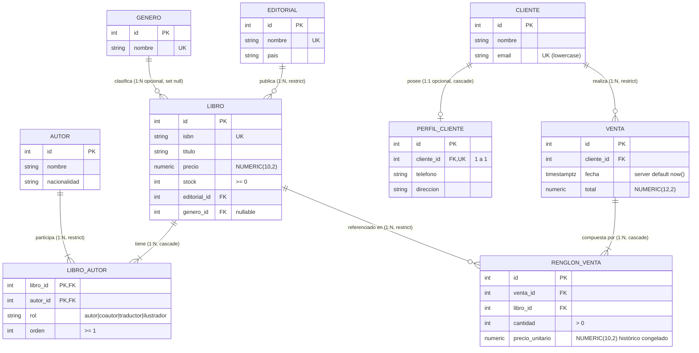

# Modelo de Datos

## Dominios

El modelo relacional se estructura en tres dominios cohesivos con bajo acoplamiento:

1. **Dominio Catálogo Editorial**:
   Gestiona las publicaciones literarias (`Libro`), las casas editoras (`Editorial`), las clasificaciones temáticas (`Genero`), y los creadores (`Autor`). La relación entre libros y autores es de muchos a muchos con datos propios de la autoría (rol y orden de aparición en la portada), modelada a través de la entidad asociativa `LibroAutor`.
2. **Dominio Clientes**:
   Administra a las personas compradoras (`Cliente`) y su información complementaria de contacto opcional (`PerfilCliente`), modelada como una relación estricta de uno a uno.
3. **Dominio Ventas**:
   Registra las transacciones comerciales (`Venta`) y sus renglones de detalle (`RenglonVenta`). Representa una relación de composición donde los renglones nacen y mueren con la venta, congelando el precio histórico del libro al momento exacto de la confirmación.

## ERD (Entity Relationship Diagram)

### Diagrama Mermaid



### Diagrama ASCII de Relaciones

```
  ┌───────────────┐               ┌───────────────┐
  │   EDITORIAL   │ 1           N │    GENERO     │
  └───────┬───────┘               └───────┬───────┘
          │ (1:N, RESTRICT)               │ (1:N, SET NULL, opcional)
          ▼                               ▼
    ┌───────────────────────────────────────────┐
    │                   LIBRO                   │◄─────────────┐
    └─────┬───────────────────────────────┬─────┘              │
          │ 1                             │ 1                  │
          │                               │                    │
          ▼ N (cascade)                   ▼ N (RESTRICT)       │
    ┌───────────────┐               ┌───────────────┐          │
    │  LIBRO_AUTOR  │               │ RENGLON_VENTA │          │
    └───────┬───────┘               └───────▲───────┘          │
            │ N                             │ N (cascade)      │ 1 (RESTRICT)
            │ (RESTRICT)                    │                  │
            ▼ 1                             │ 1                │
    ┌───────────────┐               ┌───────┴───────┐          │
    │     AUTOR     │               │     VENTA     │          │
    └───────────────┘               └───────▲───────┘          │
                                            │ N (RESTRICT)     │
                                            │                  │
    ┌────────────────┐ 1          1 │       │                  │
    │ PERFIL_CLIENTE │◄─────────────┤ CLIENTE ├────────────────┘
    └────────────────┘  (CASCADE)   └─────────┘
```

## Entidades y Diccionario de Datos

### Dominio Catálogo

#### 1. `editorial`
- `id`: `INTEGER` — Clave primaria autoincremental (`SERIAL`).
- `nombre`: `VARCHAR(100)` — Nombre oficial de la editorial. `NOT NULL`, `UNIQUE`.
- `pais`: `VARCHAR(100)` — País de origen. `NOT NULL`.

#### 2. `genero`
- `id`: `INTEGER` — Clave primaria autoincremental.
- `nombre`: `VARCHAR(50)` — Denominación del género. `NOT NULL`, `UNIQUE`.

#### 3. `autor`
- `id`: `INTEGER` — Clave primaria autoincremental.
- `nombre`: `VARCHAR(200)` — Nombre y apellido. `NOT NULL`.
- `nacionalidad`: `VARCHAR(100)` — País o nacionalidad. `NOT NULL`.

#### 4. `libro`
- `id`: `INTEGER` — Clave primaria autoincremental.
- `isbn`: `VARCHAR(20)` — Código normalizado internacional. `NOT NULL`, `UNIQUE` (`uq_libro_isbn`).
- `titulo`: `VARCHAR(200)` — Título de la obra. `NOT NULL`.
- `precio`: `NUMERIC(10,2)` — Precio unitario en ARS. `NOT NULL`, Check: `precio > 0` (`ck_libro_precio_positivo`).
- `stock`: `INTEGER` — Existencias físicas disponibles. `NOT NULL`, default `0`, Check: `stock >= 0` (`ck_libro_stock_no_negativo`).
- `editorial_id`: `INTEGER` — Clave foránea a `editorial.id`. `NOT NULL`, `ON DELETE RESTRICT`. Índice: `ix_libro_editorial_id`.
- `genero_id`: `INTEGER` — Clave foránea a `genero.id`. `NULLABLE` (agregación opcional; si es null representa "Sin clasificar"), `ON DELETE SET NULL`. Índice: `ix_libro_genero_id`.

#### 5. `libro_autor` (Entidad asociativa con atributos)
- `libro_id`: `INTEGER` — Clave foránea a `libro.id`. `NOT NULL`, `ON DELETE CASCADE`. Forma parte de la PK compuesta.
- `autor_id`: `INTEGER` — Clave foránea a `autor.id`. `NOT NULL`, `ON DELETE RESTRICT`. Forma parte de la PK compuesta. Índice: `ix_libro_autor_autor_id`.
- `rol`: `VARCHAR(20)` — Función del autor. Valores permitidos: `'autor'`, `'coautor'`, `'traductor'`, `'ilustrador'`. Check: `ck_libro_autor_rol_valido`.
- `orden`: `INTEGER` — Posición en la portada (1 para autor principal). Check: `orden >= 1` (`ck_libro_autor_orden_positivo`).
- **Clave Primaria Compuesta**: `PRIMARY KEY (libro_id, autor_id)`.

---

### Dominio Clientes

#### 6. `cliente`
- `id`: `INTEGER` — Clave primaria autoincremental.
- `nombre`: `VARCHAR(200)` — Nombre y apellido o razón social. `NOT NULL`.
- `email`: `VARCHAR(200)` — Correo electrónico de contacto. `NOT NULL`, `UNIQUE` (`uq_cliente_email`). Se almacena siempre normalizado en minúsculas.

#### 7. `perfil_cliente` (Relación 1:1 estricta con Cliente)
- `id`: `INTEGER` — Clave primaria autoincremental.
- `cliente_id`: `INTEGER` — Clave foránea a `cliente.id`. `NOT NULL`, `UNIQUE` (`ix_perfil_cliente_cliente_id`), `ON DELETE CASCADE`.
- `telefono`: `VARCHAR(50)` — Número de teléfono. `NOT NULL`.
- `direccion`: `VARCHAR(200)` — Domicilio físico. `NOT NULL`.

---

### Dominio Ventas

#### 8. `venta`
- `id`: `INTEGER` — Clave primaria autoincremental.
- `cliente_id`: `INTEGER` — Clave foránea a `cliente.id`. `NOT NULL`, `ON DELETE RESTRICT`. Índice: `ix_venta_cliente_id`.
- `fecha`: `TIMESTAMP WITH TIME ZONE` — Marca temporal UTC de la confirmación. `NOT NULL`, server default `now()`.
- `total`: `NUMERIC(12,2)` — Monto total acumulado calculado por el servidor. `NOT NULL`, default `0.00`, Check: `total >= 0` (`ck_venta_total_no_negativo`).

#### 9. `renglon_venta` (Composición con Venta y Snapshot de Precio)
- `id`: `INTEGER` — Clave primaria autoincremental.
- `venta_id`: `INTEGER` — Clave foránea a `venta.id`. `NOT NULL`, `ON DELETE CASCADE`.
- `libro_id`: `INTEGER` — Clave foránea a `libro.id`. `NOT NULL`, `ON DELETE RESTRICT`. Índice: `ix_renglon_venta_libro_id`.
- `cantidad`: `INTEGER` — Unidades compradas. `NOT NULL`, Check: `cantidad > 0` (`ck_renglon_venta_cantidad_positiva`).
- `precio_unitario`: `NUMERIC(10,2)` — **Precio unitario congelado** copiado desde el libro al momento de la venta. Check: `precio_unitario > 0` (`ck_renglon_venta_precio_unitario_positivo`).
- **Restricción de unicidad compuesta**: `UNIQUE (venta_id, libro_id)` (`uq_renglon_venta_venta_id_libro_id`). Impide que un libro figure más de una vez en la misma venta (`RN-05` / `RN-VEN-02`).

---

## Justificación de Índices en Claves Foráneas

PostgreSQL no crea índices de forma automática sobre las columnas con claves foráneas (`FOREIGN KEY`). Sin índices, las consultas de navegación inversa o las operaciones de validación referencial en eliminaciones requieren un escaneo completo de tabla (`Seq Scan`). Se implementó la siguiente estrategia:

| Clave Foránea | Índice Creado | Justificación Técnica |
|---|---|---|
| `libro.editorial_id` | `ix_libro_editorial_id` | Búsqueda rápida de libros por editorial (`GET /editoriales/{id}/libros`) y validación de borrado restrictivo. |
| `libro.genero_id` | `ix_libro_genero_id` | Filtro rápido por género en listados y consultas por género (`GET /generos/{id}/libros`). |
| `libro_autor.autor_id` | `ix_libro_autor_autor_id` | Como la clave primaria compuesta es `(libro_id, autor_id)`, el índice de la PK solo sirve para búsquedas por `libro_id`. `autor_id` requiere su propio índice para listar libros de un autor (`GET /autores/{id}/libros`). |
| `libro_autor.libro_id` | *Ninguno extra* | Ya está cubierto por ser la primera columna de la clave primaria compuesta `(libro_id, autor_id)`. |
| `perfil_cliente.cliente_id` | `ix_perfil_cliente_cliente_id` (UNIQUE) | Convierte la agregación en una relación estrictamente 1 a 1 y optimiza la lectura directa `cliente.perfil`. |
| `venta.cliente_id` | `ix_venta_cliente_id` | Optimiza la consulta del historial de ventas por cliente (`GET /clientes/{id}/ventas`). |
| `renglon_venta.libro_id` | `ix_renglon_venta_libro_id` | Permite verificar rápidamente si un libro tiene ventas asociadas antes de intentar una modificación o borrado. |
| `renglon_venta.venta_id` | *Ninguno extra* | Ya está cubierto por ser la primera columna de la restricción `UNIQUE (venta_id, libro_id)`. |

---

## Seed Data Inicial

El script `backend/scripts/seed.py` inicializa la base con los siguientes registros estándar:

### 1. Editoriales
1. `Sudamericana` (Argentina)
2. `Anagrama` (España)
3. `Emecé` (Argentina)

### 2. Géneros
1. `Novela`
2. `Cuento`
3. `Ensayo`

### 3. Autores
1. `Julio Cortázar` (argentina)
2. `Ricardo Piglia` (argentina)
3. `Adolfo Bioy Casares` (argentina)
4. `Silvina Ocampo` (argentina)
5. `Jorge Luis Borges` (argentina)

### 4. Libros y Autorías
1. **Rayuela** (ISBN: `978-950-07-0386-1`)
   - Precio: `$ 25000.00`, Stock: 10
   - Editorial: Sudamericana (1), Género: Novela (1)
   - Autores: Julio Cortázar (1, rol: `autor`, orden: 1)
2. **Bestiario** (ISBN: `978-950-07-0001-3`)
   - Precio: `$ 18000.00`, Stock: 5
   - Editorial: Sudamericana (1), Género: Cuento (2)
   - Autores: Julio Cortázar (1, rol: `autor`, orden: 1)
3. **Ficciones** (ISBN: `978-950-04-0001-9`)
   - Precio: `$ 22000.00`, Stock: 6 (inicialmente 7 antes de Venta 1)
   - Editorial: Emecé (3), Género: Cuento (2)
   - Autores: Jorge Luis Borges (5, rol: `autor`, orden: 1)
4. **Respiración artificial** (ISBN: `978-84-339-0002-0`)
   - Precio: `$ 27000.00`, Stock: 6
   - Editorial: Anagrama (2), Género: Novela (1)
   - Autores: Ricardo Piglia (2, rol: `autor`, orden: 1)
5. **Antología de la literatura fantástica** (ISBN: `978-950-04-0002-6`)
   - Precio: `$ 30000.00`, Stock: 3
   - Editorial: Emecé (3), Género: `null` (*"Sin clasificar"*)
   - Autores (3 autorías):
     - Jorge Luis Borges (5, rol: `autor`, orden: 1)
     - Silvina Ocampo (4, rol: `coautor`, orden: 2)
     - Adolfo Bioy Casares (3, rol: `coautor`, orden: 3)

### 5. Clientes y Perfiles
1. **Ana Pérez** (`ana@example.com`)
   - Perfil: Teléfono `"261 555-0101"`, Dirección `"San Martín 1200, Mendoza"`
2. **Tomás Ríos** (`tomas@example.com`)
   - Sin perfil asignado

### 6. Ventas
1. **Venta 1**:
   - Cliente: Ana Pérez (id: 1)
   - Renglones: 1 unidad del libro Ficciones (id: 3)
   - Precio unitario congelado: `$ 22000.00`, Total: `$ 22000.00`
   - Descuento de stock: Ficciones pasa de stock 7 a 6
